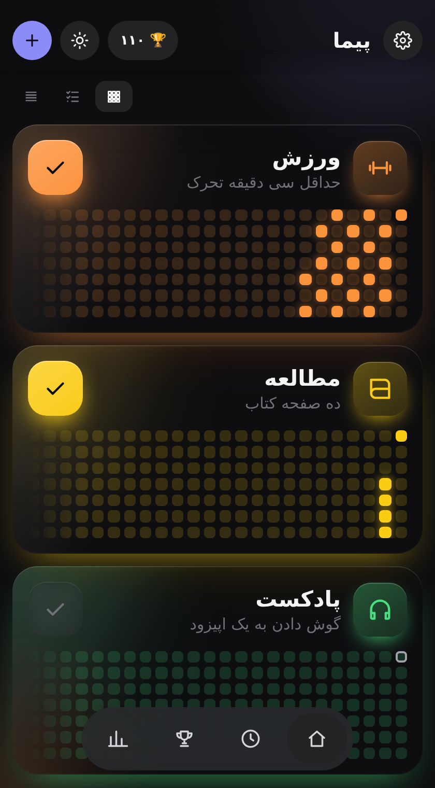
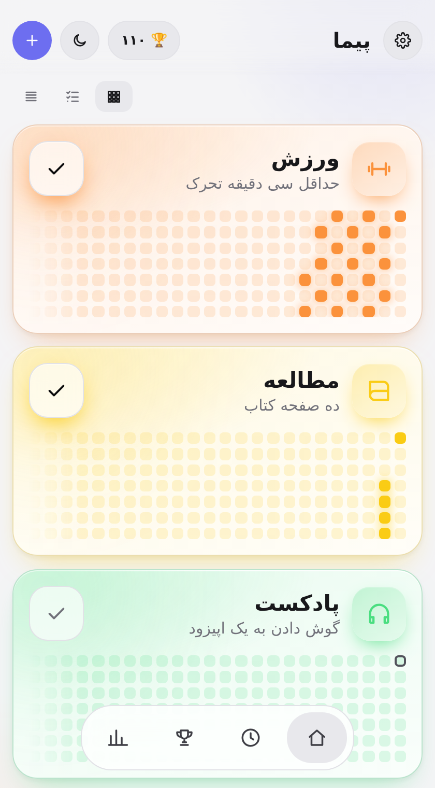
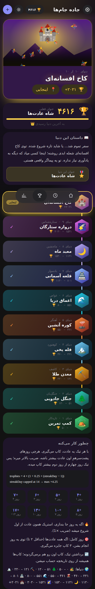

<div align="center">

# 🧭 Peyma · پیما

**A habit tracker with heatmaps, a Clash Royale-style Trophy Road, a focus timer and a full insights dashboard.**
**ردیاب عادت با هیت‌مپ، جاده جام‌ها (۱۰ دنیا با داستان)، تایمر تمرکز و داشبورد آمار.**


  

</div>

## ✨ Features | امکانات

- **Habits & heatmaps** – build / quit habits, GitHub-style heatmap per habit, streaks and streak goals
- **Trophy Road** – 10 worlds with a story each; every check-in earns trophies with a streak multiplier, and the page takes the theme of the world you are in
- **Focus timer** – presets (5 → 90 min) + custom time, can auto-complete a habit when finished
- **Insights** – 7/30/90/180-day ranges, per-habit filter, trends, weekday chart, overall heatmap, ranking
- **Companion & celebrations** – a little creature that follows your day, confetti + sound on every check-in, a full-screen card when a new world opens
- **Forgiving streaks** – earn a rest day every 7-day streak (max 2); they auto-repair a streak when you were away. Past days stay locked
- **Two-level habits** – an optional tiny "minimum" version (⚡) keeps the streak alive on low days for half the trophies; upgrade to full anytime
- **Why / if-then plan / reminder** – store your reason and an implementation intention per habit; reminders fire while the app is open
- **Mystery chest** – finish all habits for a day for a chance at a cosmetic for your companion (guaranteed on milestones, never affects trophies)
- **Share card & backup** – export a PNG progress card; download / restore a JSON backup
- **First-run welcome** – meet and name your companion, pick a few starter habits (the very first habit starts with 3 gift trophies)
- **Installable PWA** – manifest, icons, offline-first service worker, install button in Settings (iOS shows the Add-to-Home-Screen hint)
- **Self-hosted fonts** (Vazirmatn + JetBrains Mono via `@fontsource`) – no Google Fonts request, works offline and in restricted networks
- **Persian & English** (RTL / LTR), **Jalali & Gregorian** calendar
- **Dark / Light / System** theme, fully responsive (phone → desktop)
- **No backend** – everything is stored in your browser (`localStorage`), with backup / restore in Settings

## 🏆 Trophy formula | فرمول کاپ

```
trophies = 4 × (1 + 0.25 × (streakDay − 1))     // streakDay is capped at 14
perfect day (all habits, 2+ habits) = +3 bonus
```

Worlds start at 0, 51, 121, 221, 361, 551, 801, 1121, 1521 and 2021 trophies.

## 🚀 Getting started | اجرا

```bash
git clone https://github.com/<your-username>/peyma.git
cd peyma
npm install
npm run dev        # http://localhost:5173
npm run build      # production build in dist/
npm run preview    # preview the build
```

Requires Node.js 18+ (20+ recommended).

## 🗂 Project structure | ساختار

```
src/
├─ lib/core.js         # pure logic: dates, Jalali, streaks, trophy formula, worlds & stories
├─ lib/i18n.js         # Persian strings
├─ store.jsx           # state, theme, language, routing, timer, toasts
├─ components/         # Home, Detail, Stats, Road, Timer, Header, Footer, Sheets …
└─ styles.css          # design tokens (dark/light) + components
```

## 🌐 Deploy | انتشار

A GitHub Actions workflow (`.github/workflows/deploy.yml`) builds and publishes the site to **GitHub Pages** on every push to `main`.
In the repository: **Settings → Pages → Source: GitHub Actions**.

## 📄 License

MIT © Ashkan
